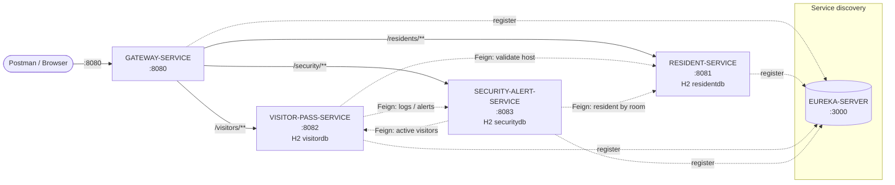
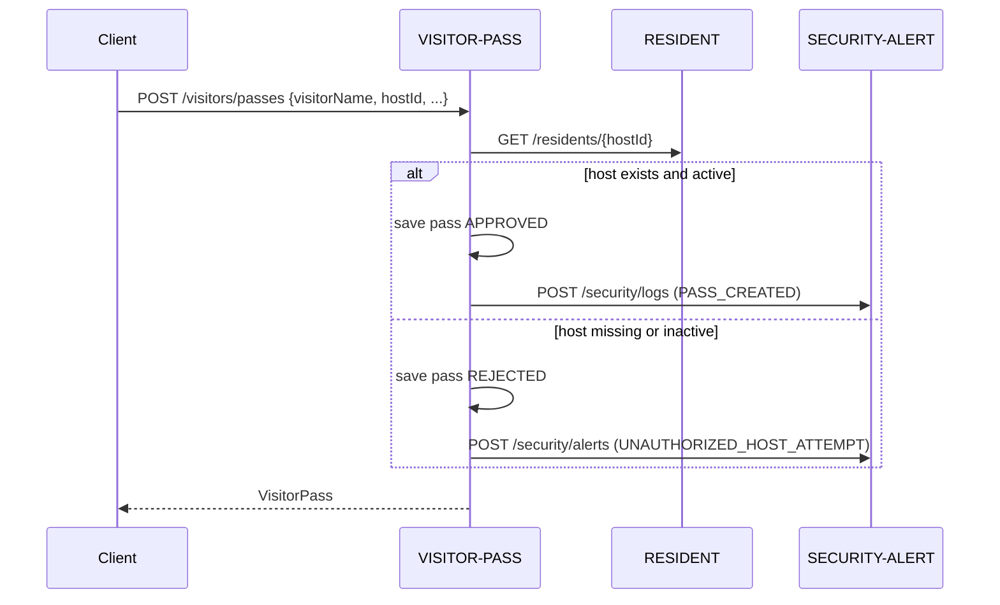
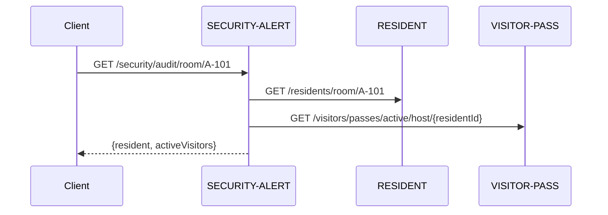

# Smart Campus – Hostel Room & Visitor Pass System

A microservices-based security and administration system for a college hostel / gated campus.
Residents are registered with their rooms, visitors get digital passes that are validated against
the host resident, and every gate event is logged by a security service that can also audit any room.

Built with **Spring Boot 4.1.2**, **Spring Cloud 2025.1** (Eureka, Gateway, OpenFeign), **Java 17** and **H2**.

| | |
|---|---|
| Team | Shreeya, Vaidehi |
| Course | Microservices Lab, 7th semester, MSRIT |
| API contract | [API_CONTRACT.md](API_CONTRACT.md) |
| Work split & git rules | [WORK_PLAN.md](WORK_PLAN.md) |

---

## Architecture



- **All external traffic goes through the gateway** (`lb://SERVICE-NAME` routes, resolved via Eureka).
- **Each domain service owns its own H2 database**; services never share tables.
- **Services call each other by Eureka name with OpenFeign**, never by hard-coded URL.

---

## Services

| Service | Port | Eureka name | Database | Responsibility | Owner |
|---|---|---|---|---|---|
| `eureka-server` | 3000 | `EUREKA-SERVER` | – | Service registry + dashboard | Shreeya |
| `gateway-service` | 8080 | `GATEWAY-SERVICE` | – | Single entry point, routes by path | Vaidehi |
| `resident-service` | 8081 | `RESIDENT-SERVICE` | `residentdb` | Students, rooms, contact details | Shreeya |
| `visitor-pass-service` | 8082 | `VISITOR-PASS-SERVICE` | `visitordb` | Issues passes, gate check-in / check-out | Vaidehi |
| `security-alert-service` | 8083 | `SECURITY-ALERT-SERVICE` | `securitydb` | Gate logs, security alerts, room audit | Shreeya |

---

## Inter-service flows

### 1. Pass creation — `POST /visitors/passes`


### 2. Gate check-in / check-out — `PUT /visitors/passes/{id}/checkin` · `/checkout`
Visitor-pass records the timestamp in its own DB and calls `POST /security/logs` with `CHECK_IN` / `CHECK_OUT`.

### 3. Room security audit — `GET /security/audit/room/{roomNumber}`

If the room has no resident → `404`. If resident-service is down → `503`.
If visitor-pass is down, the resident is still returned with an empty `activeVisitors` list.

---

## Running locally

### Prerequisites
- JDK 17 or newer (21 works)
- IntelliJ IDEA (or Maven via the bundled `./mvnw`)

### Option A — IntelliJ
1. **File → Open** the `smart-campus-system` folder; let Maven import all 5 modules.
2. Run the main classes **in this order**:
   1. `EurekaServerApplication`
   2. `ResidentServiceApplication`
   3. `SecurityAlertServiceApplication`
   4. `VisitorPassServiceApplication`
   5. `GatewayServiceApplication`
3. Open <http://localhost:3000> — all 4 clients should show **UP**.
4. Wait ~30 s after the gateway starts before calling `localhost:8080` (it returns `503` until it has fetched the registry).

### Option B — terminal
```bash
for s in eureka-server resident-service security-alert-service visitor-pass-service gateway-service; do (cd $s && ./mvnw -q clean package -DskipTests); done
```
then start each jar (Eureka first):
```bash
java -jar eureka-server/target/eureka-server-0.0.1-SNAPSHOT.jar
java -jar resident-service/target/resident-service-0.0.1-SNAPSHOT.jar
java -jar security-alert-service/target/security-alert-service-0.0.1-SNAPSHOT.jar
java -jar visitor-pass-service/target/visitor-pass-service-0.0.1-SNAPSHOT.jar
java -jar gateway-service/target/gateway-service-0.0.1-SNAPSHOT.jar
```

### Seed data
`resident-service` inserts these on every start (H2 is in-memory):

| id | name | room | active |
|---|---|---|---|
| 1 | Aarav Sharma | A-101 | true |
| 2 | Diya Patel | A-102 | true |
| 3 | Rohan Iyer | B-205 | **false** — use to demo a rejected pass |

### H2 consoles
| Service | URL | JDBC URL |
|---|---|---|
| resident | <http://localhost:8081/h2-console> | `jdbc:h2:mem:residentdb` |
| visitor-pass | <http://localhost:8082/h2-console> | `jdbc:h2:mem:visitordb` |
| security-alert | <http://localhost:8083/h2-console> | `jdbc:h2:mem:securitydb` |

User `sa`, empty password.

---

## API quick reference (all via `http://localhost:8080`)

| Method | Path | Description |
|---|---|---|
| GET | `/residents` | All residents |
| GET | `/residents/{id}` | One resident (404 if missing) |
| GET | `/residents/room/{roomNumber}` | Resident in a room (404 if empty) |
| POST | `/residents` | Add a resident |
| POST | `/visitors/passes` | Request a pass `{visitorName, visitorPhone, purpose, hostId}` |
| GET | `/visitors/passes` | All passes |
| GET | `/visitors/passes/{id}` | One pass |
| PUT | `/visitors/passes/{id}/checkin` | Gate check-in (only from `APPROVED`) |
| PUT | `/visitors/passes/{id}/checkout` | Gate check-out (only from `CHECKED_IN`) |
| GET | `/visitors/passes/active/host/{hostId}` | Active passes for a resident |
| GET | `/security/logs` | Gate event log (newest first) |
| POST | `/security/logs` | Record a gate event |
| GET | `/security/alerts` | Security alerts (newest first) |
| POST | `/security/alerts` | Raise an alert (severity defaults to `MEDIUM`) |
| GET | `/security/audit/room/{roomNumber}` | Resident + active visitors for a room |

Full field definitions: [API_CONTRACT.md](API_CONTRACT.md).

### Demo script
```bash
curl localhost:8080/residents
curl -X POST localhost:8080/visitors/passes -H 'Content-Type: application/json' \
     -d '{"visitorName":"Kiran","visitorPhone":"9000000001","purpose":"Project work","hostId":1}'
curl -X POST localhost:8080/visitors/passes -H 'Content-Type: application/json' \
     -d '{"visitorName":"Unknown","visitorPhone":"9000000002","purpose":"Visit","hostId":3}'
curl -X PUT localhost:8080/visitors/passes/1/checkin
curl localhost:8080/security/audit/room/A-101
curl -X PUT localhost:8080/visitors/passes/1/checkout
curl localhost:8080/security/logs
curl localhost:8080/security/alerts
```

---

## Deployment (OpenShift Developer Sandbox)

No code changes are needed — every client reads the registry URL from an environment variable:

```yaml
eureka:
  client:
    service-url:
      defaultZone: ${EUREKA_URI:http://localhost:3000/eureka/}
  instance:
    prefer-ip-address: true
```

1. **+Add → Import from Git** for each service with **Context Dir** `/<service-folder>` and the service's port as target port. Deploy `eureka-server` first (name it exactly `eureka-server`).
2. On the other 4 services set `EUREKA_URI = http://eureka-server:3000/eureka/`.
3. Create a **Route** only for `gateway-service` (public API) and optionally `eureka-server` (dashboard). The 3 domain services stay internal.

Step-by-step split: [WORK_PLAN.md → Phase 2](WORK_PLAN.md#phase-2-openshift).

---

## Repository layout

```
smart-campus-system/
├── pom.xml                  # aggregator (5 modules)
├── API_CONTRACT.md          # endpoints & DTOs agreed by both members
├── WORK_PLAN.md             # task split, handoffs, merge-conflict rules
├── docs/                    # screenshots for the lab record
├── eureka-server/
├── gateway-service/
├── resident-service/        # entity / repository / controller / config(DataSeeder)
├── visitor-pass-service/
└── security-alert-service/  # entity / repository / controller / client / dto
```

## Git workflow
Each member works on a personal branch (`shreeya-dev`, Vaidehi's branch), touches only the folders they own,
and merges into `main` through a pull request. See [WORK_PLAN.md](WORK_PLAN.md) for the rules.
